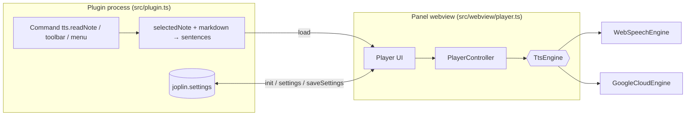

# 03 — Architecture

## Overview



Speech happens **in the webview** (that is where `speechSynthesis` and `<audio>` exist). The plugin process only prepares the text, stores settings and controls panel visibility.

## Layers

The code follows a layered (ports & adapters) architecture. **Dependencies point inwards only**; the rule is enforced by ESLint (`no-restricted-imports` per layer in `eslint.config.mjs`), so a violation fails `npm run lint`.

```
domain  <-  application  <-  adapters  <-  webview  <-  Joplin entry points
```

| Layer / module                                      | Responsibility                                                                                                       | May import                    |
| --------------------------------------------------- | -------------------------------------------------------------------------------------------------------------------- | ----------------------------- |
| `src/domain/types.ts`                               | Core types and the `TtsEngine` **port**, `Settings`                                                                  | nothing                       |
| `src/domain/markdown.ts`                            | Markdown → speakable text, line-preserving (`markdownToLines`)                                                       | domain                        |
| `src/domain/sentences.ts`                           | Sentence splitting (`Intl.Segmenter`, regex fallback)                                                                | domain                        |
| `src/domain/plan.ts`                                | Reading plan: start at cursor, or read only the selection                                                            | domain                        |
| `src/domain/chunks.ts`                              | Splits long sentences for engines with a size limit                                                                  | domain                        |
| `src/domain/settings.ts`                            | Keys, defaults and normalization of settings                                                                         | domain                        |
| `src/application/player.ts`                         | `PlayerController`: idle/playing/paused state machine (use case)                                                     | domain                        |
| `src/application/messages.ts`, `ids.ts`             | Plugin ↔ panel message protocol and content-script ids                                                               | domain                        |
| `src/adapters/*Engine.ts`, `audioSlot.ts`           | `TtsEngine` implementations: Web Speech, Google Translate, Azure, Google Cloud                                       | domain, application           |
| `src/webview/player.ts`, `playerView.ts`, `i18n.ts` | Panel wiring and engine selection (`player.ts`), DOM view (`playerView.ts`), en / pt-BR strings; runs in the browser | domain, application, adapters |
| `src/webview/viewerSelection.ts`                    | Reports the selection made in the rendered viewer                                                                    | application                   |
| `src/plugin.ts`, `index.ts`, content scripts        | Composition root: Joplin API (panel, commands, settings, content scripts)                                            | everything                    |

Every platform dependency (`speechSynthesis`, `fetch`, `Audio`) is **injected**, which allows testing everything in Jest without Joplin or a real browser.

## The `TtsEngine` interface

```ts
interface TtsEngine {
  listVoices(): Promise<Voice[]>;
  speak(text: string, options: { voiceId: string; rate: number }): Promise<void>;
  cancel(): void;
}
```

An engine speaks **one sentence at a time**. `speak` resolves when the sentence ends **or is cancelled** and only rejects on a real failure. The original idea also included `pause()`, `resume()` and `setRate()`; the implementation opted for a smaller contract (see "Pause" below).

## `PlayerController`

- States: `idle` → `playing` ⇄ `paused`; after the last sentence it returns to `idle` at sentence 0.
- Each utterance gets a **generation**; results from utterances that were already replaced (pause, seek, stop, voice/speed change) are discarded. This avoids races when the engine resolves a cancelled utterance.
- **Pause**: cancels the current sentence; `resume` **repeats the sentence from its start**. This is more reliable across engines than `speechSynthesis.pause()`, which behaves inconsistently on some platforms.
- Changing **speed or voice** while reading restarts the current sentence with the new value.
- Engine errors pause the player and are reported through `onError` (the UI shows the message).

## Message protocol

Plugin → panel:

| `type`     | Fields                           | When                                                        |
| ---------- | -------------------------------- | ----------------------------------------------------------- |
| `init`     | `settings`                       | Panel sent `ready`                                          |
| `settings` | `settings`                       | User changed settings                                       |
| `load`     | `title`, `sentences`, `autoplay` | "Read note" command (autoplay) or note switch (no autoplay) |
| `stop`     | —                                | "Stop" command                                              |

Panel → plugin:

| `type`         | Fields  | Effect                                                  |
| -------------- | ------- | ------------------------------------------------------- |
| `ready`        | —       | Handshake: plugin sends `init` (and any pending `load`) |
| `reload`       | —       | Reloads the current note without autoplay               |
| `saveSettings` | `patch` | Persists the voice/speed chosen in the panel            |
| `close`        | —       | Hides the panel                                         |

The `ready` handshake exists because messages sent before the webview loads are lost. The "read note" command keeps a _pending autoplay_ until `ready` arrives. Switching notes with the panel open reloads **without autoplay**, so audio never starts unexpectedly.

The webview accepts the payload either directly or wrapped in `{ message }`, since the shape delivered by `webviewApi.onMessage` varies between Joplin versions.

## Reading the note

1. `selectedNote()` → Markdown `body`.
2. `markdownToPlainText` removes code blocks, images/resources (`:/id`), URLs, HTML, list/task/quote/heading markers, emphasis, tables and footnotes; backslash-escaped characters are preserved.
3. `splitSentences`: every line/paragraph is a sentence boundary (headings and list items without a final period become separate sentences); fragments without a letter/digit are dropped.
4. Optionally (`readTitle`) the title is the first sentence.

## Build

- The official template's `webpack` (`generator-joplin`) produces `dist/index.js` and the `.jpl`.
- The panel script (`src/webview/player.ts`) is bundled as a **browser bundle** by a small local tweak to `webpack.config.js` (extra scripts under `webview/` are not treated as _content scripts_). The CSS is copied from `src/` to `dist/`.
