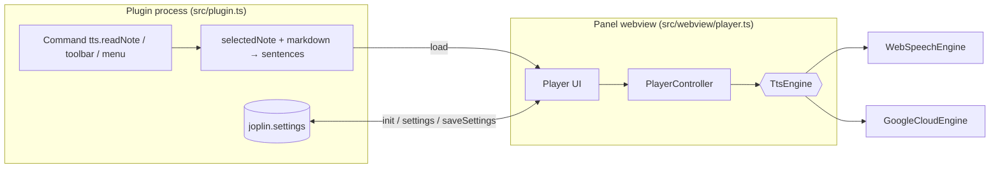

# 03 — Architecture

## Overview

PlantUML sources (render with the PlantUML extension or `plantuml doc/spec/diagrams/*.puml`):
[`diagrams/architecture.puml`](diagrams/architecture.puml) (components and layers, with Piper) and
[`diagrams/piper-sequence.puml`](diagrams/piper-sequence.puml) (choose the engine, download, read).



Speech happens **in the webview** (that is where `speechSynthesis` and `<audio>` exist). The plugin process only prepares the text, stores settings and controls panel visibility.

## Layers

The code follows a layered (ports & adapters) architecture. **Dependencies point inwards only**; the rule is enforced by ESLint (`no-restricted-imports` per layer in `eslint.config.mjs`), so a violation fails `npm run lint`.

```
domain  <-  application  <-  adapters  <-  webview  <-  Joplin entry points
```

| Layer / module                                                                             | Responsibility                                                                                                                                                      | May import                    |
| ------------------------------------------------------------------------------------------ | ------------------------------------------------------------------------------------------------------------------------------------------------------------------- | ----------------------------- |
| `src/domain/types.ts`                                                                      | Core types and the `TtsEngine` **port**, `Settings`                                                                                                                 | nothing                       |
| `src/domain/markdown.ts`                                                                   | Markdown → speakable text, line-preserving (`markdownToLines`)                                                                                                      | domain                        |
| `src/domain/sentences.ts`                                                                  | Sentence splitting (`Intl.Segmenter`, regex fallback)                                                                                                               | domain                        |
| `src/domain/plan.ts`                                                                       | Reading plan: start at cursor, or read only the selection                                                                                                           | domain                        |
| `src/domain/chunks.ts`                                                                     | Splits long sentences for engines with a size limit                                                                                                                 | domain                        |
| `src/domain/settings.ts`                                                                   | Keys, defaults and normalization of settings                                                                                                                        | domain                        |
| `src/application/player.ts`                                                                | `PlayerController`: idle/playing/paused state machine (use case)                                                                                                    | domain                        |
| `src/application/messages.ts`, `ids.ts`                                                    | Plugin ↔ panel message protocol and content-script ids                                                                                                              | domain                        |
| `src/application/piperDialog.ts`, `piperStore.ts`                                          | Logic of the Piper voice screen (list, download, remove, select) and the `PiperStore` port                                                                          | domain                        |
| `src/adapters/*Engine.ts`, `audioSlot.ts`                                                  | `TtsEngine` implementations: Web Speech, Google Translate, Azure, Google Cloud, Piper                                                                               | domain, application           |
| `src/adapters/piperStorage.ts`, `piperSynth.ts`                                            | Piper files on disk and downloads (`PiperStore`), and the synthesizer (eSpeak + ONNX); Node side, injected `fs`/`fetch`                                             | domain, application           |
| `src/domain/piperCatalog.ts`, `piperRuntime.ts`, `wav.ts`                                  | Voice catalog parsing, pinned runtime files (SHA-256), WAV encoding                                                                                                 | domain                        |
| `src/webview/player.ts`, `playerView.ts`, `i18n.ts`                                        | Panel wiring and engine selection (`player.ts`), DOM view (`playerView.ts`), en / pt-BR strings; runs in the browser                                                | domain, application, adapters |
| `src/webview/viewerSelection.ts`                                                           | Reports the selection made in the rendered viewer                                                                                                                   | application                   |
| `src/webview/voicePickerView.ts`                                                           | DOM of the Piper voice screen                                                                                                                                       | domain, application           |
| `src/webview/engines.ts`                                                                   | Engine registry: one factory per engine (`ENGINE_FACTORIES`) and the `EngineEnv` they receive                                                                       | domain, application, adapters |
| `src/compose/` (`nodePlatform.ts`, `pluginRoot.ts`)                                        | **Composition root of the plugin process**: the only place that reads the Joplin API and Node globals (`fs`, `fetch`, `require`) to build services                  | everything                    |
| `src/plugin.ts`, `piper.ts`, `piperGate.ts`, `piperPicker.ts`, `index.ts`, content scripts | Joplin integration (panel, commands, settings), Piper service (explicit dependencies), the rules that keep Piper from being used without a voice, voice-screen flow | everything                    |

Every platform dependency (`speechSynthesis`, `fetch`, `Audio`) is **injected**, which allows testing everything in Jest without Joplin or a real browser.

## The `TtsEngine` interface

```ts
interface TtsEngine {
  listVoices(): Promise<Voice[]>;
  speak(text: string, options: { voiceId: string; rate: number }): Promise<void>;
  cancel(): void;
  prefetch?(text: string, options: { voiceId: string; rate: number }): void; // optional hint
}
```

An engine speaks **one sentence at a time**. `speak` resolves when the sentence ends **or is cancelled** and only rejects on a real failure. `prefetch` is an optional hint: while a sentence plays, `PlayerController` tells the engine which sentence comes next, so the online engines can fetch its audio in the background (Azure and Google Cloud keep the result in a one-entry `PrefetchCache`; Google Translate preloads the audio element). If the background attempt fails, the engine simply fetches again when the sentence is due. The original idea also included `pause()`, `resume()` and `setRate()`; the implementation opted for a smaller contract (see "Pause" below).

## `PlayerController`

- States: `idle` → `playing` ⇄ `paused`; after the last sentence it returns to `idle` at sentence 0.
- Each utterance gets a **generation**; results from utterances that were already replaced (pause, seek, stop, voice/speed change) are discarded. This avoids races when the engine resolves a cancelled utterance.
- **Pause**: cancels the current sentence; `resume` **repeats the sentence from its start**. This is more reliable across engines than `speechSynthesis.pause()`, which behaves inconsistently on some platforms.
- Changing **speed or voice** while reading restarts the current sentence with the new value.
- Engine errors pause the player and are reported through `onError` (the UI shows the message).

## Message protocol

Plugin → panel:

| `type`             | Fields                           | When                                                        |
| ------------------ | -------------------------------- | ----------------------------------------------------------- |
| `init`             | `settings`                       | Panel sent `ready`                                          |
| `settings`         | `settings`                       | User changed settings                                       |
| `load`             | `title`, `sentences`, `autoplay` | "Read note" command (autoplay) or note switch (no autoplay) |
| `stop`             | —                                | "Stop" command                                              |
| `openVoicePicker`  | `revertible`                     | Piper chosen without a voice, or the Piper voices command   |
| `closeVoicePicker` | —                                | The engine was changed elsewhere                            |

Panel → plugin:

| `type`            | Fields            | Effect                                                                    |
| ----------------- | ----------------- | ------------------------------------------------------------------------- |
| `ready`           | —                 | Handshake: plugin sends `init` (and any pending `load`)                   |
| `reload`          | —                 | Reloads the current note without autoplay                                 |
| `saveSettings`    | `patch`           | Persists the voice/speed chosen in the panel                              |
| `progress`        | `index`           | Sentence being read or paused on (`null` when idle): drives the highlight |
| `piperVoices`     | —                 | Answer: the downloaded voices (`{ voices }`)                              |
| `piperSynthesize` | `text`, `voiceId` | Answer: `{ ok: true, wav }` (base64 WAV) or `{ ok: false, error }`        |
| `piperPicker`     | `request`         | Voice screen: list / download / remove / select; answer: a `DialogState`  |
| `piperPickerDone` | `confirm`         | Voice screen closed: confirm the voice or go back to another engine       |
| `close`           | —                 | Hides the panel (and gives up the voice screen if it is open)             |

The `ready` handshake exists because messages sent before the webview loads are lost. The "read note" command keeps a _pending autoplay_ until `ready` arrives. Switching notes with the panel open reloads **without autoplay**, so audio never starts unexpectedly.

The webview accepts the payload either directly or wrapped in `{ message }`, since the shape delivered by `webviewApi.onMessage` varies between Joplin versions.

## Highlighting the sentence being read

The panel reports every change of the current sentence (`progress`). The plugin keeps the reading plan it sent (`ReadingPlan.highlights`: for each sentence, its line and its columns inside the raw Markdown line, found by `domain/locate.ts`, which skips the markup removed during conversion) and shows the highlight in two places:

- **Markdown editor (CodeMirror 6)**: the plugin runs `editor.execCommand` with the command `tts.highlight`, registered by the editor content script. It moves a decoration (`.tts-current-sentence`) over the sentence and scrolls it into view. If a sentence cannot be located, the whole line is highlighted. A selection plan has no line information, so nothing is highlighted in the editor.
- **Rendered viewer**: a plugin cannot push messages into the rendered note, so `webview/viewerSelection.js` **polls** the plugin every 500 ms (`{ type: 'poll' }` → `{ highlight: text | null }`) and `viewerHighlight.ts` finds that text in the page and marks it with the CSS Custom Highlight API (`::highlight(tts-current)`), without touching the DOM. Browsers without that API simply show no highlight.

## Piper (offline engine)

Piper runs in the **plugin process** (Node), not in the panel: the plugin keeps the model files in a local folder and only the audio of each sentence crosses to the panel, which plays it (`PiperEngine`, a `TtsEngine` like the others, asks the plugin with `piperSynthesize`; the answer of `webviewApi.postMessage` is the handler's return value).

- **Folder** (`<plugin data dir>/piper`): `runtime/` (eSpeak phonemizer and ONNX Runtime, WebAssembly, pinned versions, SHA-256 checked, written atomically) and `voices/<id>/` (`model.onnx`, `model.onnx.json`, `meta.json` written last, so a half download is never listed).
- **Synthesis** (`PiperSynthesizer`): eSpeak turns the text into phoneme ids (`piper_phonemize`), the voice (ONNX Runtime, `wasm` provider) produces PCM, which becomes a WAV. Requests are queued: one ONNX session cannot run two inferences at once.
- **Catalog**: `voices.json` of `rhasspy/piper-voices`, read from the **Piper voices URL** setting. It gives each voice's id, locale, quality and file sizes (the MB shown).
- **Voice screen**: Joplin's dialog API has no plugin-side `onMessage`, so a dialog cannot talk to the plugin; the screen is drawn **inside the player panel** instead (`voicePickerView.ts`, state in `PiperDialogController`, flow in `VoicePickerFlow`). Download progress has no push channel, so the screen asks for the state every 500 ms while it is open.
- **Gate**: when the engine setting becomes `piper` and the saved voice is not downloaded, the plugin opens the screen (`revertible`). Confirming saves the voice (and the engine); giving up, or closing the panel, restores the previous non-Piper engine. Reading with Piper and no downloaded voice opens the screen instead of reading.

## Reading the note

1. `selectedNote()` → Markdown `body`.
2. `markdownToPlainText` removes code blocks, images/resources (`:/id`), URLs, HTML, list/task/quote/heading markers, emphasis, tables and footnotes; backslash-escaped characters are preserved.
3. `splitSentences`: every line/paragraph is a sentence boundary (headings and list items without a final period become separate sentences); fragments without a letter/digit are dropped.
4. Optionally (`readTitle`) the title is the first sentence.

## Build

- The official template's `webpack` (`generator-joplin`) produces `dist/index.js` and the `.jpl`.
- The panel script (`src/webview/player.ts`) is bundled as a **browser bundle** by a small local tweak to `webpack.config.js` (extra scripts under `webview/` are not treated as _content scripts_). The CSS is copied from `src/` to `dist/`.

## Dependency injection

There is no container: services receive what they need through their constructor or parameters, and **one composition root per runtime** wires them.

- **Plugin process:** `compose/pluginRoot.ts` (`composePiper`) reads the Joplin data folder and `compose/nodePlatform.ts` (`fs`, `fetch`, `require`); `createPiper` then receives all its dependencies explicitly and touches no global.
- **Panel:** `initPlayer` builds one `EngineEnv` (browser features, strings, `request`) and `webview/engines.ts` maps each engine id to a factory; adding an engine means registering a factory.
- **Rules:** `piperGate.ts` holds the Piper-without-a-voice rules, out of `plugin.ts`; the ESLint layer rules also forbid every inner layer from importing `compose`.
