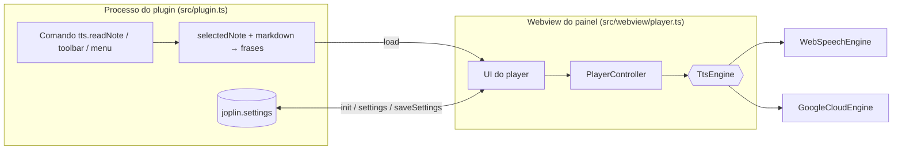

# 03 — Arquitetura

## Visão geral



A fala acontece **no webview** (é lá que existem `speechSynthesis` e `<audio>`). O processo do plugin só prepara o texto, guarda configurações e controla a visibilidade do painel.

## Módulos

| Módulo                         | Responsabilidade                                                                   | Depende de Joplin/DOM? |
| ------------------------------ | ---------------------------------------------------------------------------------- | ---------------------- |
| `src/index.ts`                 | Registra o plugin                                                                  | Joplin                 |
| `src/plugin.ts`                | Painel, comandos, botão, menu, configurações, ciclo de mensagens                   | Joplin                 |
| `src/lib/markdown.ts`          | Markdown → texto falável (remove código, links, imagens, HTML, marcadores)         | não                    |
| `src/lib/sentences.ts`         | Divisão em frases (`Intl.Segmenter`, com fallback por regex); título como 1ª frase | não                    |
| `src/lib/player.ts`            | `PlayerController`: máquina de estados idle/playing/paused, seek, taxa, voz        | não                    |
| `src/lib/webSpeechEngine.ts`   | Motor `speechSynthesis`                                                            | DOM (injetado)         |
| `src/lib/googleCloudEngine.ts` | Motor Google Cloud TTS (`fetch` + `<audio>` injetados)                             | não                    |
| `src/lib/settings.ts`          | Chaves, padrões e normalização de configurações                                    | não                    |
| `src/lib/i18n.ts`              | Textos en / pt-BR                                                                  | não                    |
| `src/webview/player.ts`        | UI do painel e ligação com o controlador                                           | DOM                    |

Toda dependência de plataforma (`speechSynthesis`, `fetch`, `Audio`) é **injetada**, o que permite testar tudo em Jest sem Joplin nem navegador real.

## Interface `TtsEngine`

```ts
interface TtsEngine {
  listVoices(): Promise<Voice[]>;
  speak(text: string, options: { voiceId: string; rate: number }): Promise<void>;
  cancel(): void;
}
```

Um motor fala **uma frase por vez**. `speak` resolve quando a frase termina **ou é cancelada** e só rejeita em falha real. A intenção original previa também `pause()`, `resume()` e `setRate()`; a implementação optou por um contrato menor (ver "Pausa" abaixo).

## `PlayerController`

- Estados: `idle` → `playing` ⇄ `paused`; ao fim da última frase volta a `idle` na frase 0.
- Cada fala recebe uma **geração**; resultados de falas já substituídas (pause, seek, stop, troca de voz/velocidade) são descartados. Isso evita corridas quando o motor resolve uma fala cancelada.
- **Pausa**: cancela a frase atual; `resume` **repete a frase desde o início**. É mais confiável entre motores do que `speechSynthesis.pause()`, que tem comportamento inconsistente em algumas plataformas.
- Mudar **velocidade ou voz** durante a leitura reinicia a frase atual com o novo valor.
- Erros do motor pausam o player e são notificados em `onError` (a UI mostra a mensagem).

## Protocolo de mensagens

Plugin → painel:

| `type`     | Campos                           | Quando                                                        |
| ---------- | -------------------------------- | ------------------------------------------------------------- |
| `init`     | `settings`                       | Painel avisou `ready`                                         |
| `settings` | `settings`                       | Usuário mudou configurações                                   |
| `load`     | `title`, `sentences`, `autoplay` | Comando "ler nota" (autoplay) ou troca de nota (sem autoplay) |
| `stop`     | —                                | Comando "parar"                                               |

Painel → plugin:

| `type`         | Campos  | Efeito                                             |
| -------------- | ------- | -------------------------------------------------- |
| `ready`        | —       | Handshake: plugin envia `init` (e `load` pendente) |
| `reload`       | —       | Recarrega a nota atual sem autoplay                |
| `saveSettings` | `patch` | Persiste voz/velocidade escolhidas no painel       |
| `close`        | —       | Oculta o painel                                    |

O handshake `ready` existe porque mensagens enviadas antes de o webview carregar se perdem. O comando "ler nota" guarda um _autoplay pendente_ até o `ready` chegar. A troca de nota com o painel aberto recarrega **sem autoplay**, para o áudio nunca começar de surpresa.

O webview aceita o payload direto ou embrulhado em `{ message }`, pois a forma entregue por `webviewApi.onMessage` varia entre versões do Joplin.

## Leitura da nota

1. `selectedNote()` → `body` Markdown.
2. `markdownToPlainText` remove blocos de código, imagens/recursos (`:/id`), URLs, HTML, marcadores de lista/tarefa/citação/cabeçalho, ênfases, tabelas e notas de rodapé; preserva caracteres escapados.
3. `splitSentences`: cada linha/parágrafo é fronteira de frase (títulos e itens sem ponto final viram frases separadas); frases sem letra/dígito são descartadas.
4. Opcionalmente (`readTitle`) o título é a primeira frase.

## Build

- `webpack` do template oficial (`generator-joplin`) gera `dist/index.js` e o `.jpl`.
- O script do painel (`src/webview/player.ts`) é empacotado como **bundle de navegador** por um pequeno ajuste local em `webpack.config.js` (extra scripts em `webview/` não são tratados como _content scripts_). O CSS é copiado de `src/` para `dist/`.
