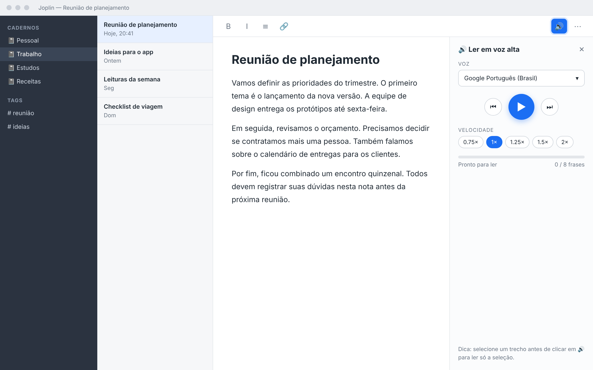
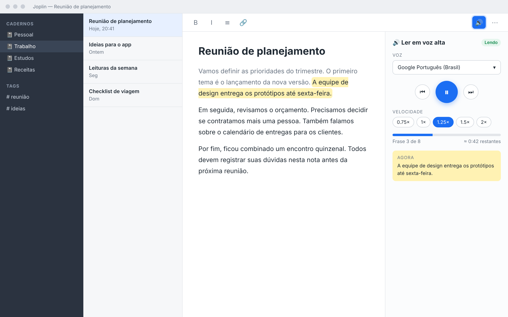
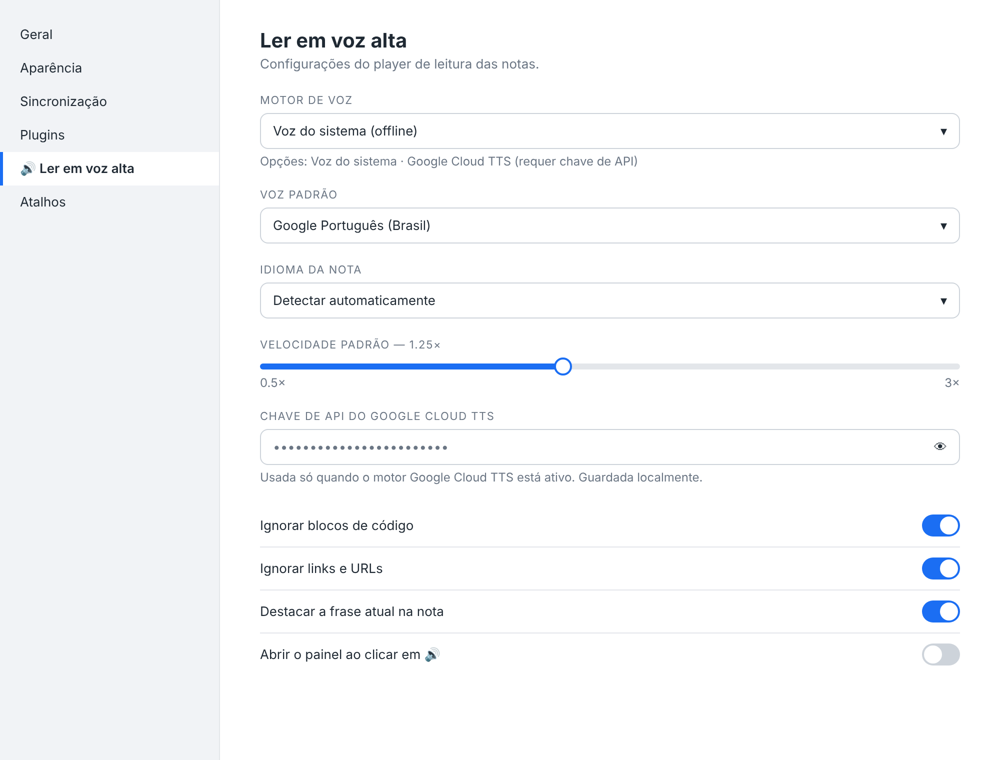
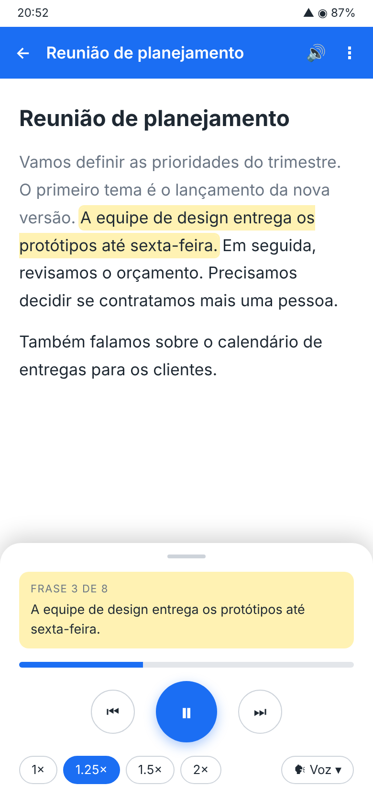

# 04 — Protótipo de UI

Na sessão de design foram geradas quatro telas de protótipo (HTML renderizado em PNG: `01-desktop-parado`, `02-desktop-lendo`, `03-configuracoes`, `04-android`). O layout foi **aprovado** ("Eu gostei"). As imagens estão em [img/](img/).

## Telas

1. **Desktop parado** — botão 🔊 na barra da nota; painel com voz, play, velocidade e progresso.
2. **Desktop lendo** — frase atual destacada na nota, botão de pausa, velocidade 1.25× e "Frase 3 de 8".
3. **Configurações** — motor de voz (sistema ou Google Cloud TTS), voz, velocidade padrão, chave de API e opções de leitura.
4. **Android** — player em painel inferior com a frase atual, play/pause, velocidades e seletor de voz. Mostra o **caso ideal**; no Android pode ser necessário o motor via API.

### Desktop parado

### Desktop lendo

### Configurações

### Android

## Implementação na v0.1

| Elemento do protótipo                    | Estado                                                             |
| ---------------------------------------- | ------------------------------------------------------------------ |
| Botão na barra da nota                   | Implementado (`tts.readNote`, `ToolbarButtonLocation.NoteToolbar`) |
| Painel com voz, play/pause, velocidade   | Implementado                                                       |
| Anterior / próxima / parar               | Implementado (extra em relação ao mockup)                          |
| "Frase N de M" + barra de progresso      | Implementado                                                       |
| Frase atual **no painel**                | Implementado                                                       |
| Frase atual **destacada dentro da nota** | **Planejado** — é a parte mais difícil (ver roadmap)               |
| Tela de configurações                    | Implementada na seção nativa de configurações do Joplin            |
| Velocidades 0.75×, 1×, 1.25×, 1.5×, 2×   | Implementado (valores fora da lista são acrescentados à lista)     |
| Layout Android em painel inferior        | Depende do suporte do Joplin mobile; usa o mesmo painel            |

## Tema e acessibilidade

O CSS usa as variáveis `--joplin-*` (cor, fundo, fonte, divisor), então acompanha o tema claro/escuro do Joplin. Os botões têm `title` descritivo e os estados `disabled` quando não há texto para ler.
