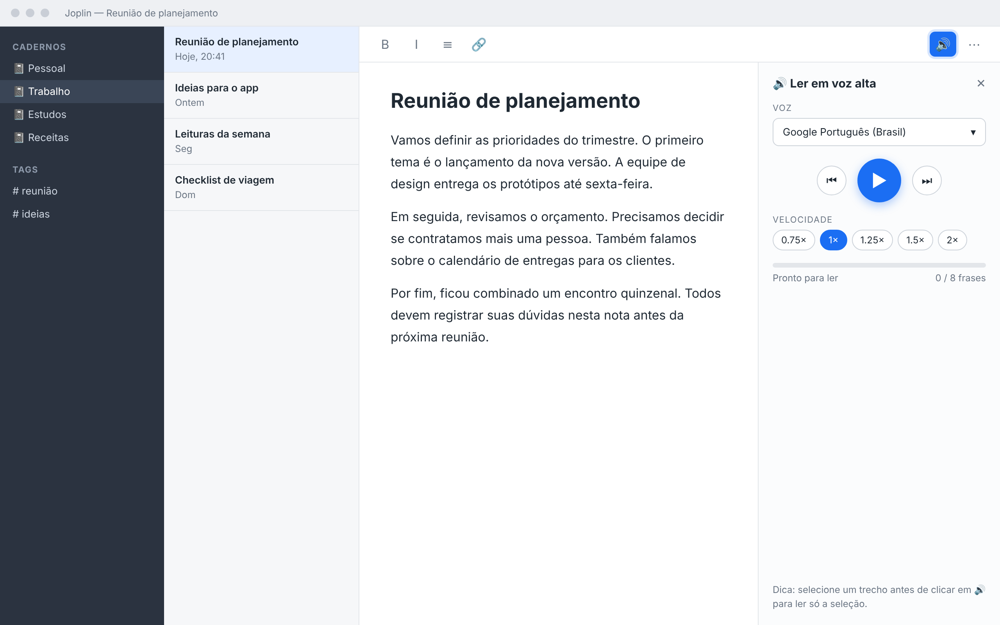
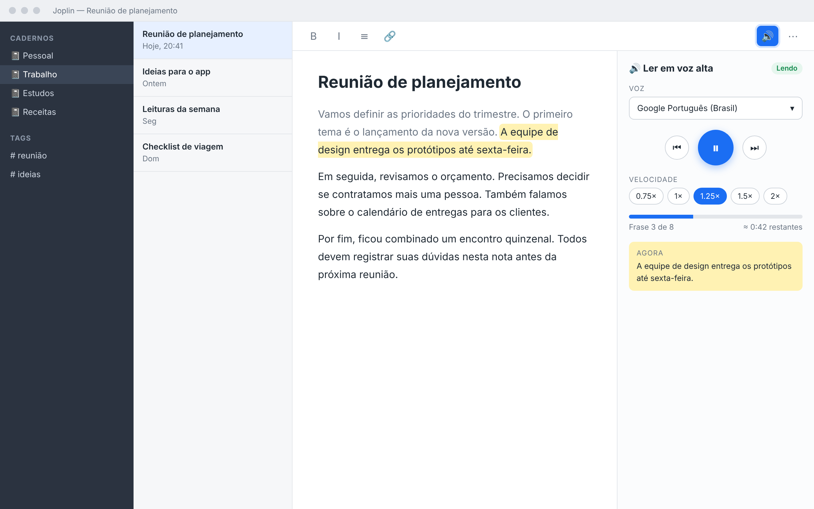
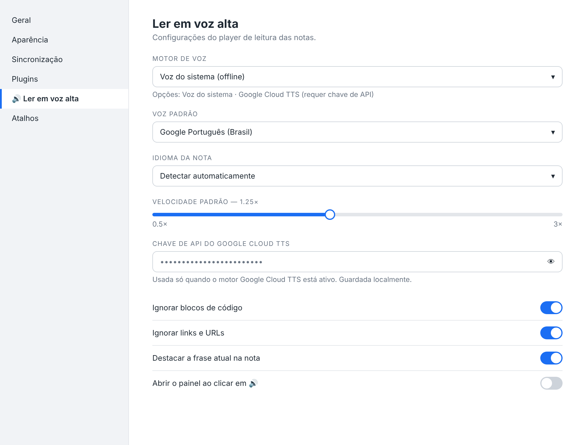
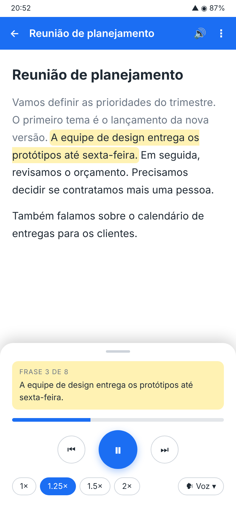

# 04 — UI prototype

During the design session four prototype screens were generated (HTML rendered to PNG: `01-desktop-idle`, `02-desktop-reading`, `03-settings`, `04-android`). The layout was **approved** ("I liked it"). The images are in [img/](img/).

## Screens

1. **Desktop idle** — 🔊 button in the note toolbar; panel with voice, play, speed and progress.
2. **Desktop reading** — current sentence highlighted in the note, pause button, 1.25× speed and "Sentence 3 of 8".
3. **Settings** — speech engine (system, Google Translate, Azure or Google Cloud TTS), voice, default speed, API key and reading options.
4. **Android** — bottom-panel player with the current sentence, play/pause, speeds and voice selector. Shows the **ideal case**; on Android the API-based engine may be needed.

### Desktop idle

### Desktop reading

### Settings

### Android

## Implementation in v0.1

| Prototype element                        | Status                                                            |
| ---------------------------------------- | ----------------------------------------------------------------- |
| Toolbar button (note + editor toolbars)  | Implemented (`tts.readNote`, `ToolbarButtonLocation.NoteToolbar`) |
| Panel with voice, play/pause, speed      | Implemented                                                       |
| Previous / next / stop                   | Implemented (extra compared to the mockup)                        |
| "Sentence N of M" + progress bar         | Implemented                                                       |
| Current sentence **in the panel**        | Implemented                                                       |
| Current sentence **highlighted in note** | **Planned** — the hardest part (see roadmap)                      |
| Settings screen                          | Implemented in Joplin's native settings section                   |
| Speeds 0.75×, 1×, 1.25×, 1.5×, 2×        | Implemented (values outside the list are added to it)             |
| Android bottom-panel layout              | Depends on Joplin mobile support; uses the same panel             |

## Theme and accessibility

The CSS uses the `--joplin-*` variables (color, background, font, divider), so it follows Joplin's light/dark theme. Buttons have descriptive `title`s and `disabled` states when there is nothing to read.
